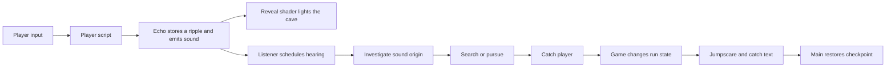

# How ECHO is built

ECHO is a first-person Godot 4 stealth-horror game. The player explores a dark cave by making sounds. The same sounds that reveal the cave can attract blind monsters called Listeners. The main objective is to reach the exit; checkpoints, pebbles, logs, journals and upgrades support that journey. A second level extends the run.

Most gameplay is written in GDScript. Godot supplies the renderer, physics, audio playback, controls and navigation engine. The project code connects those systems and defines the rules. The browser version comes from Godot's web export. The repository description mentioning three.js does not describe the current `game/` implementation.

## 1. What the files mean

| File/folder | Purpose |
|---|---|
| `game/project.godot` | Project settings, startup scene, inputs, global scripts and renderer configuration. Open this file in Godot. |
| `game/scenes/*.tscn` | Text files describing nodes, positions, collision shapes and references to scripts or other scenes. |
| `game/scripts/*.gd` | The gameplay and interface code. |
| `game/shaders/reveal.gdshader` | GPU code that makes cave surfaces appear when a ripple passes. |
| `game/assets/` | Models, textures, fonts and runtime jumpscare frames. |
| `game/audio/` | Recordings and the Freesound library. |
| `assets/listener/` | Editable creature source, Blender scripts and exports outside the Godot project's resource folder. |
| `game/tests/` | Automated gameplay, scene, jumpscare and dialogue checks. |
| `game/.godot/` | Godot's generated local import cache; this is not the source project and should stay out of Git. |

A `.glb` is a model/animation export that Godot imports. A `.blend` is the editable Blender source. A `.tscn` places assets and attaches behavior; a `.gd` script makes those nodes do things.

## 2. What happens when you launch it

The startup scene is [main.tscn](game/scenes/main.tscn). It contains a Player, Level, UI, environment and sun.

Four scripts start automatically and remain available by name across scene reloads:

| Global script | Responsibility |
|---|---|
| [Game](game/scripts/game_state.gd) | Run state, checkpoint, inventory, upgrades, health, statistics and save files. |
| [Echo](game/scripts/echo_system.gd) | Active ripple positions, ages and radii; sound signals heard by enemies. |
| [Sfx](game/scripts/sfx.gd) | Sound lookup, playback, fallback sound generation, reverb and mixing helpers. |
| [Settings](game/scripts/settings.gd) | Saved options and applying changes to controls, audio, display and accessibility. |

[main.gd](game/scripts/main.gd) chooses the level, finds its spawn marker, resets the run and puts the player there. It adds the director and cutscene controller, then shows the title screen or resumes a run. Level scripts apply reveal materials and prepare props. Enemy navigation is baked after the cave's collision geometry is ready.

The persistent game states are TITLE, PLAYING, CAUGHT, WON and CUTSCENE. Those states determine when the player can act and what the UI displays. The pause menu pauses the scene tree separately; releasing the mouse while playing also pauses it.

## 3. The core loop



A **signal** is an event notification. For example, `Game.player_caught` tells Main, the player and director that a catch occurred. Each reacts to that event without having to own the other systems' code.

## 4. Player movement and actions

[player.gd](game/scripts/player.gd) controls a `CharacterBody3D`. Every physics tick it reads movement, applies gravity and acceleration, calls Godot's collision-aware movement, and updates actions. Mouse/controller look rotates the body and camera head.

The base speeds are 3.5 m/s walking, 1.6 sneaking and 5.5 running. Sprint stamina lasts four seconds, with recovery rules that prevent unlimited sprinting. Jumping, landing, wall contact, hiding and holding breath affect movement or noise. Camera motion has separate settings for bob, landing motion and shake.

| Action | Current base rule |
|---|---|
| Loud ping | 22 m radius, 2 s cooldown. Crystal upgrades can reduce cooldown to 0.8 s. |
| Buffered ping | A press in the final 0.25 s of cooldown can fire once when ready. |
| Whisper | 6 m visual ripple, independent 2.5 s cooldown; does not notify enemies as a loud sound. |
| Walking/running | Ordinary footstep hearing ranges are 3 m / 9 m. |
| Sneaking | Normal footsteps are silent; special noisy floor areas still have their own rules. |
| Hold breath | Up to six seconds; running out produces a gasp. |
| Pebble | Hold to aim, release to throw; starts with three pebbles and a maximum capacity of five. |

The gold aiming arc predicts the pebble's motion using gravity, damping and collision ray tests. The actual pebble uses Godot's rigid-body physics. The old player chalk-mark/F action has been removed; environmental direction arrows remain part of the level.

## 5. How a ripple reveals the cave

The player asks `Echo.emit_ping()` to create a ripple. Echo stores its origin, age and maximum radius. Each frame, it sends those values to global shader parameters.

There are eight slots: four for player/whisper ripples and four for pebble ripples. A group takes a free slot first, otherwise its oldest slot. Pebbles therefore cannot erase the player's current ripple.

The reveal shader calculates each surface point's distance from the ripple origin. A soft outgoing ring reveals that surface, afterglow fades, and a faint return ring creates the bouncing visual. The ring eases its motion but reaches its maximum range at `radius / 18` seconds. Some landmarks hold their glow longer; world materials can retain faint memory traces.

This is a designed radial effect. The return ring is calculated mathematically around the origin; it does not trace sound reflections off individual cave walls. Pebble collisions create additional actual ping events at the bounce locations.

## 6. How Listeners behave

[listener.gd](game/scripts/listener.gd) owns enemy decisions. [ai_nav.gd](game/scripts/ai_nav.gd) builds a navigation mesh from the cave's collision faces, and a `NavigationAgent3D` supplies path points around obstacles. If navigation is unavailable, the enemy has a simpler movement fallback.

A loud sound within range records its origin and schedules hearing using distance divided by the sound speed, 18 m/s. A sound already due to arrive sooner is retained so repeated footsteps cannot keep postponing the reaction. The Listener then turns, pauses in Alert and investigates that recorded position.

| Mode | Behavior |
|---|---|
| PATROL | Walk its route or move between two patrol points. |
| LISTEN | Stop, sweep its head and listen. |
| ALERT | Face a newly heard sound before moving. |
| INVESTIGATE | Move toward the sound, or pursue a player it can sense. |
| SEARCH | Look around at the destination, then give up if nothing is found. |
| WANDER | Follow a director hint with a minimum distance from the player. |
| CHASE | Run the separately scripted chase sequence. |

Ordinary pursuit uses proximity, hiding/quiet status and a clear-line test. Once sight is lost, it retains a last known position rather than updating the target through rock. Its existing loss timer gives it time to search. Scripted chases have their own deliberate behavior. After several successful pebble lures, Listeners can adapt and investigate the thrower's location.

The walking creature uses the imported Listener model plus the body/animation helpers in `ai_listener_body.gd` and `ai_listener_anim.gd`.

## 7. How the cave and progression work

The two level scenes contain cave geometry, collision, spawn points, enemies and trigger areas. Props are supplied by companion `level_props.tscn` and `level2_props.tscn` scenes. [level.gd](game/scripts/level.gd) applies materials, prepares textures, creates environmental arrows, adds dust and manages the color reveal.

Cave textures use triplanar mapping: the shader blends projections from different axes so the constructed cave surfaces can be textured without individually unwrapping each shape.

[trigger.gd](game/scripts/trigger.gd) handles different area types: checkpoint, pebbles, voice log, exit, crystal, hint, zone, journal and dagger. Entering an area or interacting with a recorder produces the appropriate Game event.

Checkpoints record position, facing and pebble inventory. Crystals improve ping radius, cooldown or carrying capacity. Logs/journals update progress and display text. Entering an exit calls `Game.win()`. The ending reveals ordinary lit materials and daylight, making the contrast with the dark cave part of the payoff.

## 8. Damage modes and the jumpscare

**No Damage** is the default. Monsters still catch the player and send them to the checkpoint. There is no health bar or usable knife.

**Damage** enables the existing health and dagger combat. The player starts with 20 maximum health; Listeners have 15 health. A normal dagger hit deals five damage, reduced at low player health. The same catch sequence runs when the player dies.

The actual in-game jumpscare is a full-screen animation atlas generated from the Blender render: 38 frames at 24 fps, about 1.58 seconds, with synchronized recorded audio. [jumpscare.gd](game/scripts/jumpscare.gd) advances an `AtlasTexture` on a `TextureRect`. The source atlas is 3840 × 2520 pixels, with 640 × 360 frames in six columns. This uses ordinary 2D rendering in the Compatibility renderer.

`UI.caught_out()` plays that attack, covers the screen with black and shows the catch message/tip. Main then restores the checkpoint and calls `caught_in()` to fade back. Skip jumpscare uses a gentle fade instead. The editable four-second Blender source and GLB export remain under `assets/listener/jumpscare/`.

## 9. Dialogue, menus and sound

[ui.gd](game/scripts/ui.gd) builds the HUD, prompts, dialogue boxes and screen effects. Separate `menu_*.gd` files handle title, pause, settings, credits and ending pages. `ui_cutscene.gd` handles cinematic cameras, letterbox bars and cutscene text. `ui_map.gd` draws the explored route and ping positions.

Dialogue uses Godot Labels inside a panel and containers. Its width must stay fixed while its height adapts to wrapped text. Resetting both dimensions to their minimum caused the one-letter-wide bug: the panel shrank to 45 pixels and left one pixel for the text. The repair resets only height, clamps width to the window and keeps it centered. A single cancellable tween timeline handles typing at 45 characters/s, reading time and fade-out.

Sound playback prefers configured Freesound recordings, then event-named files under `game/audio/`, then procedural fallbacks when needed. Several footsteps/pebble events can choose variants. Positional audio gives enemies and impacts locations; ambience, heartbeat, reverb and the director's scripted events build tension. No external audio API is called during gameplay. Source credits and licenses are stored with the audio library.

## 10. Where to make a change

| If you want to change… | Start here |
|---|---|
| Controls, movement, stamina, ping cooldown use | `game/scripts/player.gd` |
| Initial inventory, upgrades, checkpoint/save rules | `game/scripts/game_state.gd` |
| Ripple slots and sound events | `game/scripts/echo_system.gd` |
| Ripple appearance, return ring and afterglow | `game/shaders/reveal.gdshader` |
| Enemy hearing, targets and modes | `game/scripts/listener.gd` |
| Enemy paths | `game/scripts/ai_nav.gd` and level collision geometry |
| Cave layout and object placement | The relevant `game/scenes/level*.tscn` |
| Pickups and interactive areas | `game/scripts/trigger.gd` |
| Dialogue/HUD | `game/scripts/ui.gd` |
| Cutscene camera and cinematic text | `game/scripts/ui_cutscene.gd` |
| Menu behavior | The corresponding `game/scripts/menu_*.gd` |
| Audio source selection and playback | `game/scripts/sfx.gd` |
| Background tension and scripted scares | `game/scripts/director.gd`, `audio_ambience.gd` |
| Full-screen catch animation | `game/scripts/jumpscare.gd`, `game/assets/jumpscare/` |

The simplest ownership rule is: Player makes actions; Echo broadcasts sounds; Listener chooses enemy targets; Game stores progress; Main coordinates scene transitions; UI presents the result. Keep those boundaries rather than putting all logic into one large manager.

To run automated checks without modifying a player's settings/saves:

```sh
python3 game/tests/run_checks.py /path/to/godot
```

The runner uses a disposable copy with a separate application name. Headless checks cover logic and layout; a human browser playtest is still needed for pointer lock, the final sound mix and the exported web experience.
